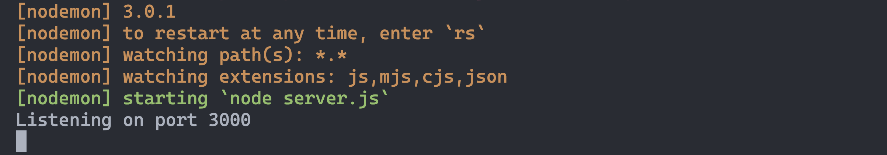

# 

**Learning objective:** By the end of this lesson, students will be able to build the basic structure of an **Express** server and know how to start it.

## Install the Express Module

Before we begin building our server, we'll need to install the Express module in this project:

```bash
npm i express
```

> 📚 Note that `i` is an alias for `install`.

Now, the Express framework is available to use when building our application. Without this step, if we were to try to run our server code, we would receive an error since our app would be trying to import code from a node module that we haven't installed yet.

Now that `express` is installed, let's write the basic code to create our server.

## Basic Structure of Express App

Here is an outline of what a typical Express app does - let’s put this guide right in our **`server.js`** file:

```js
// Here is where we import modules.
// We begin by loading Express:

const express = require('express')

/* The "express" variable we just created has a lot of different functionalities
that help developers build web applications. We could have called it
anything, but let's stick to something meaningful.*/

/* Below, we use Express () to generate an "app" object and assign it to a
variable. The "app" object has methods like creating
routes and having the server start listening for requests. */
const app = express()

// Here is where we will mount our routes (left intentionally empty, for now):


// Tell the app to listen on port 3000 for client requests.
app.listen(3000, () => {
  console.log('Listening on port 3000')
})
/*  */
```

> 📚 **`server.js`** file is typically the main entry point and configuration file for setting up an Express web server.

We assign our server to listen at port `3000` in the code above. Every computer has thousands of ports on which it can listen for requests, but each port can only be assigned to one software application at a time. Once assigned, requests can come into that port and be handled by the application, much like a boat sails into an actual port in real life.

## Nodemon

To run the app, we could use the `node` keyword followed by the name of the file you would like to run (in our case, `server.js`):

```bash
node server.js
```

However, any time changes are made to the application's code using this method, you'll have to stop and restart the server, ***every time!***

There is a better way... **NODEMON!**

[`nodemon`](https://www.npmjs.com/package/nodemon) is a popular command line tool that automatically restarts our Express app when we save changes to its code. No more need to continually restart the server all the time!

Install it using:

```bash
sudo npm i -g nodemon
```

> 🧠 We usually install command-line tools using the `-g` (global) option. Depending on your computer, `sudo` may or may not be necessary.

## Run the Server

Now that we have `nodemon` installed, we can run our server with the command:

```bash
nodemon server.js
```

However, we can make this even easier by updating our `package.json` `main` property to point to our `server.js` file. This will allow us to run our server with the command:

```bash
nodemon
```

> 📚 When we ran the command `npm init -y` we accepted all the default values. The default value for the `main` property is `index.js`. We can change this to `server.js` by updating the `main` property in our `package.json` file.

Our server should be up and running, and you should see something like this:



## Review Questions

1. What is the purpose of the `express` module?
2. What is the purpose of the `app` object?
3. What is the purpose of the `listen` method?
