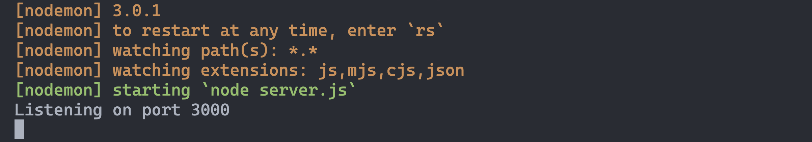

# 

tktk - we renamed this microlesson

**Learning Objective:** By the end of this lesson, students will understand how to set up a basic Express server and make it listen for requests.

## Setting Up Express in your project

Before we start coding, let's set up the Express framework:

### Installing Express

- To include Express in your project, run:

  ```bash
  npm i express
  ```

> 📚 Remember `i` is shorthand for `install`. This command adds the Express module to your project by adding it to your `package.json` and `node modules` folder.

### Writing the server code

Now, let's add the `Express` package to the `server.js` file that will house our server code:

Importing `Express` and creating the application:

```js
// Import Express
const express = require('express')

// Create an Express app
const app = express()
```
- Here, `express` is a function that, when called, returns an instance of an Express application (`app`).

> 📚 By convention the **`server.js`** file is typically the main entry point and configuration file for setting up an Express web server.

Defining routes and starting the server:

```js
// Define routes here (we'll add them soon)

// Listen for requests on port 3000
app.listen(3000, () => {
  console.log('Listening on port 3000')
})
```

- The `listen` method starts the server on a specified port (3000 in this case).

### Understanding Ports

Think of ports like doors on a computer. Port `3000` is a common choice for local development, but you can use most other unreserved ports.

## Running your Express server with Node

After setting up your initial server code in `server.js`, it's time to run it and see it in action!

1. Start the server:
   - Open your terminal and navigate to the directory containing your `server.js` file.
   - Run the server using Node:

     ```bash
     node server.js
     ```

2. Check the terminal output:

   - Once the server starts, you should see a message in your terminal:
     ```
     Listening on port 3000
     ```
   This message is generated by the `console.log` statement in the `listen` method, indicating that your server is successfully running and listening for requests on port 3000! 🎉

   > The message confirms that your Express server is up and active. It's now ready to respond to requests sent to `localhost:3000`.


## Running your Express server with Nodemon for development

Running a JavaScript file in the terminal using Node executes the file in its current state. As you build and modify server files, you'll often want to test changes quickly. This typically requires saving your file and rerunning the server code to apply these changes. Manually restarting the server for every update can become tedious, but thankfully this process can be automated with a helpful NPM package [Nodemon](https://www.npmjs.com/package/nodemon). 

Nodemon is a valuable tool for Node development. It monitors your files for changes and automatically restarts the application, removing the repetitive task of manual server restarts after each modification. This feature streamlines the development process, allowing you to focus more on coding and less on managing your server in the terminal.

### Installing Nodemon

- Install Nodemon:
  ```bash
  npm i nodemon
  ```

### Running the server with Nodemon

- Start your server with Nodemon:
  ```bash
  nodemon server.js
  ```

## Check the terminal

Once the server is running, you should see a confirmation in your terminal, indicating that it's listening on port 3000. These colorful logs come from the Nodemon package and provide helpful information about the status of your server as your code changes. 

