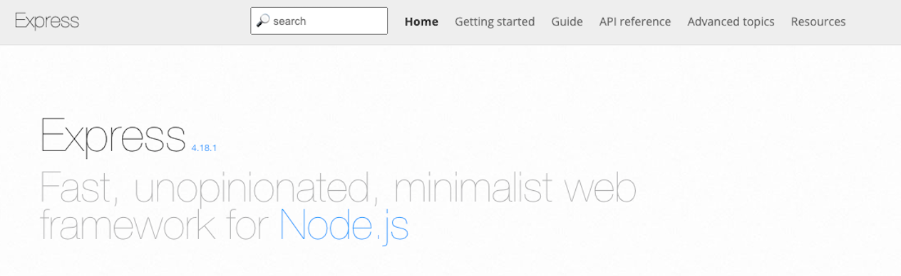

# ![[Introduction to Express] - Concepts](./assets/hero.png)

**Learning objective:** By the end of this lesson, students will be able to briefly describe what **Express** is, what it does, and why web application frameworks are beneficial.

## The Three Fundamental Capabilities of Web Application Frameworks

**Web Application Frameworks** are frameworks designed to help developers build server-side applications faster. They usually contain the following capabilities:

1. The ability to define "routes" so that client applications can make requests to them.
2. The ability to process incoming requests.
3. The ability to generate responses by combining data with templates.

## The Express Framework

[**Express**](https://expressjs.com/) is the most popular web application framework for Node.js, and one of the most popular web application frameworks across all technologies. 

Express is fairly flexible and minimalist, meaning developers have more control over how they build their applications. It also means that there's less to learn to get started!

