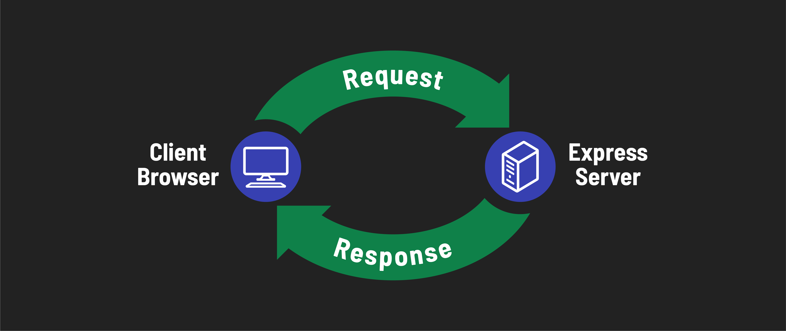

# 

**Learning objective:** By the end of this lesson, students will be able to briefly describe what **Express** is, what it does, and why web application frameworks are beneficial.

## The Express Framework

[**Express**](https://expressjs.com/) is the most popular web application framework for Node.js and one of the most popular web application frameworks across all technologies. Express is relatively flexible and minimalist, meaning developers have more control over how they build their applications. It also means that there's less to learn to get started!

Express can be used to build a variety of applications, including:

- **Web applications** - Express can be used to build web applications that serve HTML pages to users.
- **APIs** - Express can be used to build APIs that serve data to client applications.
- **Web servers** - Express can be used to build web servers that serve static files to users.

We are going to be focusing on using Express to build web applications.

## The Three Fundamental Capabilities of Web Application Frameworks

**Web Application Frameworks** are frameworks designed to help developers build server-side applications faster. They usually contain the following capabilities:

1. The ability to define "routes" so that client applications can make requests to them.
2. The ability to process incoming requests.
3. The ability to generate responses by combining data with templates.

## Review Questions

1. What is Express?
2. What are the three fundamental capabilities of web application frameworks?
3. What examples of applications can be built with Express?