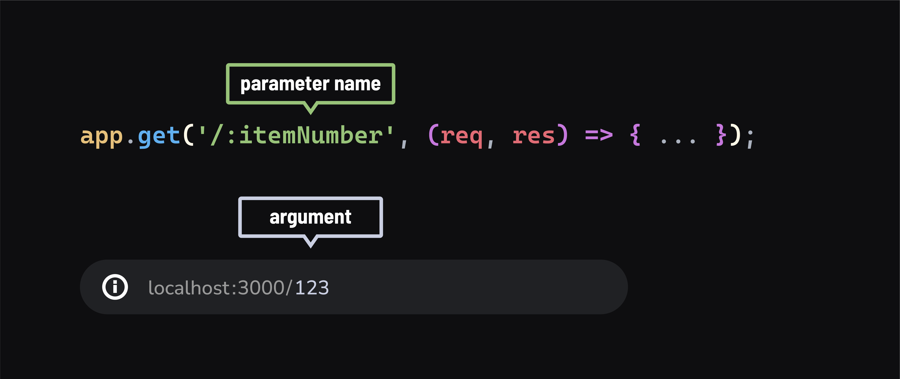

# 

**Learning objective:** By the end of this lesson, students will be able to describe how parameters are used in URLs to access specific requested data.

## URL/Route Parameters

In our web apps we will often need to pass information, such as an identifier for a certain data resource, in the **path** of the HTTP request.

**URL Parameters**, also known as **Route Parameters**, work like parameters in functions, providing a way for data to pass into the route's callback function via the URL of the request.

Similar to JavaScript functions, where we define parameters in the function definition and pass arguments when the function is called, URL parameters act as placeholders in a route definition. When a request is made to that route, the actual values in the URL are treated as arguments.



In Express, we define route parameters in the **path string** using a colon, followed by the parameter name.

Here's an example:

```javascript
app.get('/:itemNumber', (req, res) => {
  // Prints: 123
  console.log(req.params.itemNumber);

  // Will send an H1 in the response with the content: Item 123
  res.send(`<h1>Item ${req.params.itemNumber}</h1>`);
});
```

In your browser, visit [`localhost:3000/123`](http://localhost:3000/123). Now visit [`localhost:3000/456`](http://localhost:3000/456). You should see the item number change from 123 to 456. Change the number to anything you want, and the page should update accordingly upon refresh.

In the above route, the path `/:itemNumber` tells Express to create a route whose path is a `/` followed by any string (e.g. 123, 456, foo, bar, etc). When a matching request comes in, Express will then create a property on `req.params` with a key of `itemNumber` and a value of whatever comes after the slash in the path of the request.

If the URL is [`localhost:3000/123`](http://localhost:3000/123) then `req.params.itemNumber` has the value 123.  If the URL is [`localhost:3000/456`](http://localhost:3000/456) then `req.params.itemNumber` has the value 456.
