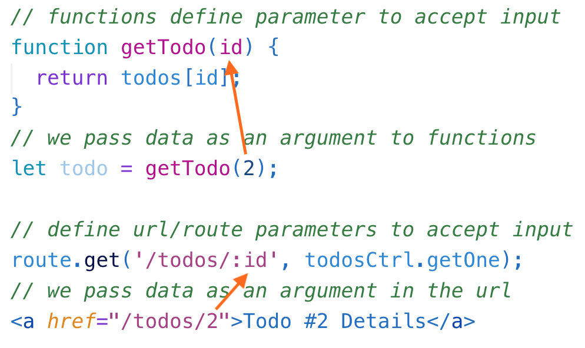

# ![[Introduction to Express] - URL Parameters](./assets/hero.png)

**Learning objective:** By the end of this lesson, students will be able to tktk

### URL/Route Parameters

In our web apps, we will often need to pass information, such as an identifier ***(often times an id)*** for a certain data resource, in the **path** of the HTTP request.

**URL Parameters**, also known as **Route Parameters**, just like parameters in functions, provide a way for data to pass into the router & controller via the URL of the request.

In Express, we define **route parameters** in the **path string** using a **colon**, followed by the **parameter name**.

Let's look at this analogy...



To implement show functionality, so that we can view individual todos we need to utilize `req.params`.

^ **[tktk tktk What is show functionality? Uh oh.]**


Express’s `req.params` object will have a property for each route parameter defined. For example, a route defined like this:

```bash
router.get('/category/:catName/', ...)
```

and a link like this:

```html
<a href="/category/socks">Socks!</a>
```

would have a `req.params` available in the controller of:

```js
console.log(req.params.catName) //=> "socks"
```

Note that all route param values are strings.


> 😎 Your understanding of this concept is vital to your success this unit, but you likely won't grasp it immediately - this is something that comes with repetition and you're going to get a lot of it this unit.
